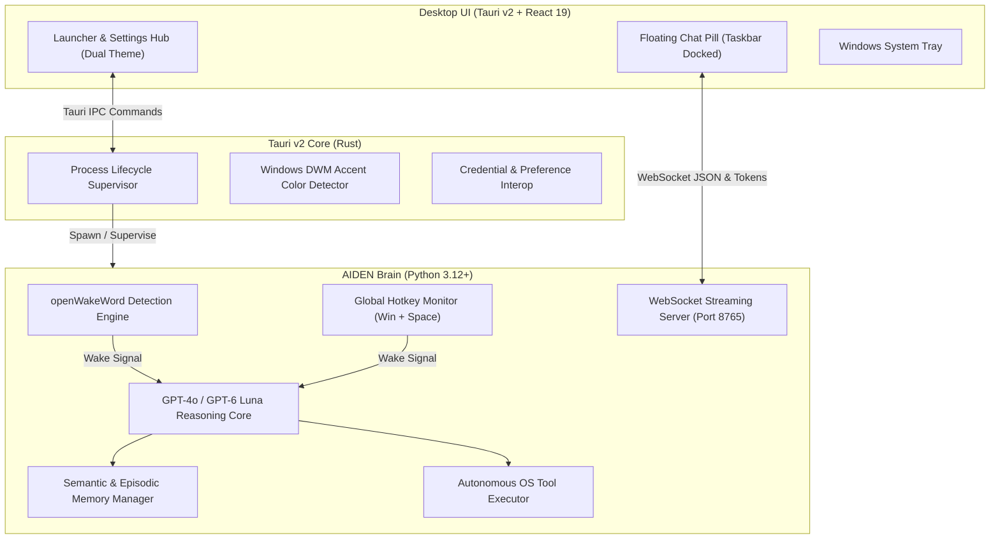

# AIDEN Assistant 🔮

> **Aiden** is an intelligent, voice-first desktop companion living directly within the hardware of Windows. Built with a high-performance **Tauri v2 + Rust** desktop core, a **React 19 + TypeScript** interface, and an autonomous **Python AI reasoning engine**.

---

## ✨ Highlights & Core Features

* 🎙️ **Offline Wake Word Detection**: Ultra-low latency voice activation powered by local ONNX/TFLite models (`backend/models/aiden.onnx`). Activates hands-free on *"Hey Aiden"* or *"Aiden"*, or via global hotkey (`Win + Space`).
* 💬 **Floating Taskbar Chat Pill**: A borderless, transparent floating interface docked right above the Windows taskbar:
  * **Smooth Token Streaming**: Asynchronous WebSocket streaming with a 60fps adaptive token pacemaker.
  * **Dynamic Windows Accent Bezel**: Automatically detects and adapts to your active Windows accent color (`HKCU\Software\Microsoft\Windows\DWM\AccentColor`).
  * **Orb Status Indicator**: 3 counter-rotating SVG filaments with a breathing core and real-time status telemetry (*Thinking*, *Opening app*, *Checking weather*).
  * **Click-Through Transparency**: Automatically sleeps and ignores cursor events when idle, waking instantly on interaction.
* 🎛️ **Settings Launcher & Control Hub**:
  * **Dual-Theme Fluid Circular Transition**: Seamless toggle between Cinematic Dark Velvet and Warm Biscuit Cream with an origin-aware circular reveal.
  * **Long-Term Memory Manager**: Visual dashboard for long-term facts stored in `%LOCALAPPDATA%\AidenAssistant\memory.json`. Supports custom category columns, inline fact editing (`✎`), fact deletion (`🗑`), and dynamic category creation with hidden scrollbars for a clean UI.
  * **Process Lifecycle Supervision**: Complete background process orchestration (Boot up, Restart, Shutdown, and Minimize to System Tray).
* 🛠️ **Autonomous System Tools**:
  * Fast fuzzy matching and launching of installed Windows applications.
  * System telemetry (battery level, CPU usage, Wi-Fi status, live time).
  * Safe PowerShell script execution.
  * Media controls (Spotify & YouTube playback, volume adjustment, mute/unmute).
  * Local file search.
* 🔒 **Secure Credential Storage**: Zero plaintext API keys on disk. Credentials are encrypted and persisted directly in the **Windows Credential Manager** via native OS APIs.

---

## 🏛️ System Architecture



---

## 📁 Repository Structure

```
AIDEN_assistant/
├── backend/
│   ├── models/                # Trained offline wake-word models (aiden.onnx & aiden.tflite)
│   ├── main.py                # Main assistant loop & state machine (Sleep ⟷ Awake)
│   ├── server.py              # Asynchronous WebSocket server streaming tokens to UI
│   ├── wake_word.py           # Threaded microphone listener & openWakeWord classifier
│   ├── shortcut_detector.py   # Global keyboard shortcut hook (Win + Space)
│   ├── tools_system.py        # System tools: installed apps, PowerShell, media, weather
│   ├── memory_manager.py      # Long-term semantic categories & episodic ledger manager
│   ├── configuration.py       # Identity vibe, immutable rules, and preference loader
│   ├── auth_manager.py        # Windows Credential Manager integration (keyring)
│   ├── requirements.txt       # Python dependencies
│   └── *.py                   # Telemetry, app registry & connector modules
├── frontend/
│   ├── src/
│   │   ├── components/
│   │   │   ├── ChatPill.tsx   # Floating taskbar chat interface & animated orb
│   │   │   └── ChatPill.css   # Dynamic accent bezels & spring animations
│   │   ├── App.tsx            # Main Control Hub (Auth, Preferences, Memory, Control)
│   │   └── App.css            # Circular theme wipe, custom tabs & hidden scrollbars
│   ├── src-tauri/
│   │   ├── src/
│   │   │   ├── lib.rs         # Tauri commands, multi-window layout & process manager
│   │   │   └── main.rs        # Tauri entrypoint
│   │   ├── Cargo.toml         # Rust dependencies
│   │   └── tauri.conf.json    # Dual-window configuration (main launcher + chat_pill)
│   ├── package.json           # Frontend dependencies (React 19, TypeScript, Vite)
│   └── vite.config.ts         # Vite bundler settings
├── .gitignore                 # Clean root gitignore (excludes target, venv, node_modules)
└── README.md                  # Project overview & documentation
```

---

## 🚀 Getting Started

### Prerequisites

* **Operating System**: Windows 10 / 11 (64-bit)
* **Python**: `3.12+` (with `pip` and virtual environment support)
* **Node.js**: `v18+` or `v20+` and `npm`
* **Rust**: `1.75+` with `cargo` installed via [rustup.rs](https://rustup.rs/)
* **C++ Build Tools**: Visual Studio C++ Build Tools (required for Rust and PyAudio)

---

### Installation & Setup

#### 1. Clone the Repository
```bash
git clone https://github.com/your-username/AIDEN_assistant.git
cd AIDEN_assistant
```

#### 2. Set Up the Backend
```bash
cd backend
python -m venv venv
.\venv\Scripts\activate
pip install -r requirements.txt
cd ..
```

#### 3. Set Up the Frontend
```bash
cd frontend
npm install
cd ..
```

---

### 🏃 Running in Development Mode

Run the unified Tauri development environment from the `frontend` folder:

```bash
cd frontend
npm run tauri dev
```

This will:
1. Start the Vite development server on `http://localhost:1420/`.
2. Compile and launch the Rust/Tauri desktop shell.
3. Automatically position the **Floating Chat Pill** right above your Windows taskbar.
4. Launch the **AIDEN Control Launcher** on your screen.
5. Provide live hot-reloading for frontend components.

---

### 🔑 Providing Your OpenAI API Key

1. When opening the Launcher for the first time, click **Have a key already?** or expand the **Authentication** section.
2. Paste your OpenAI API key (`sk-...`).
3. Click **Save**.
   * Your key will be securely saved into the **Windows Credential Manager** (`AidenAssistant/openai_api_key`). No API keys are ever committed or stored in plaintext.

---

### 🎮 Usage & Hotkeys

| Action | Trigger | Description |
| :--- | :--- | :--- |
| **Wake Aiden** | Voice (*"Hey Aiden"*) or `Win + Space` | Activates listening mode; floating pill expands |
| **Dismiss / Sleep** | `Win + Space` or click outside | Returns Aiden to dormant sleep mode |
| **Open Launcher** | Click System Tray icon or taskbar | Opens settings, preferences, and memory manager |
| **Toggle Theme** | Top-left Sun/Moon icon in Launcher | Circular ripple transition between Dark and Light mode |
| **Minimize to Tray** | Top-right `X` button on Launcher | Minimizes the control panel to the Windows system tray |
| **Complete Exit** | System Tray Context Menu ➔ **Quit** | Shuts down backend background processes and closes windows |

---

### 🧠 Long-Term Memory System

Aiden organizes long-term memories across customizable categories (e.g., `General`, `Preferences`, `Personal`, `Projects`) saved to:
```
%LOCALAPPDATA%\AidenAssistant\memory.json
```
* In the **Launcher ➔ Memory** tab, you can create custom category columns, add memories, and edit (`✎`) or delete (`🗑`) individual facts.
* Past conversations are automatically summarized and stored in:
```
%LOCALAPPDATA%\AidenAssistant\episodic_ledger.json
```

---

### 📦 Building for Production

To compile a production installer / standalone executable:

```bash
cd frontend
npm run tauri build
```

The output executable and MSI installer will be created in:
```
frontend/src-tauri/target/release/bundle/
```

---

## 🛡️ License

This project is licensed under the MIT License — see the LICENSE file for details.

