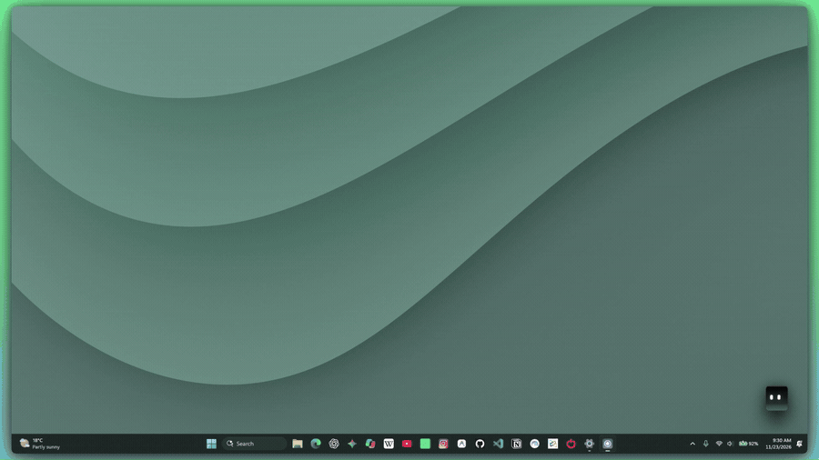
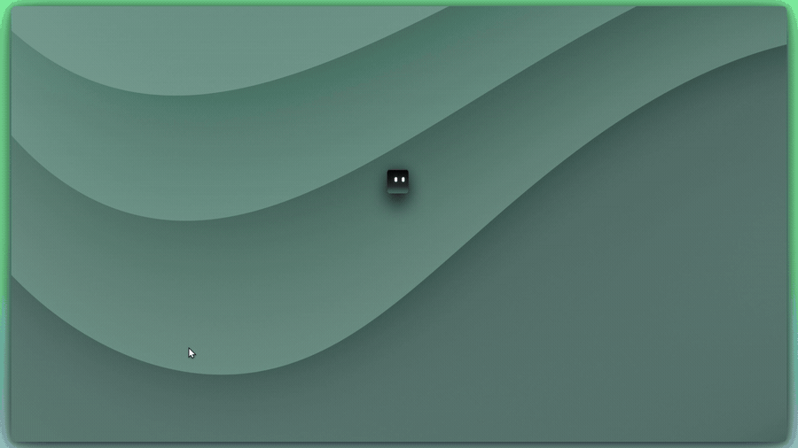
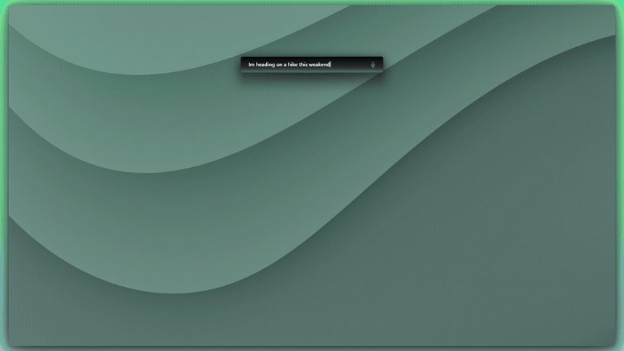
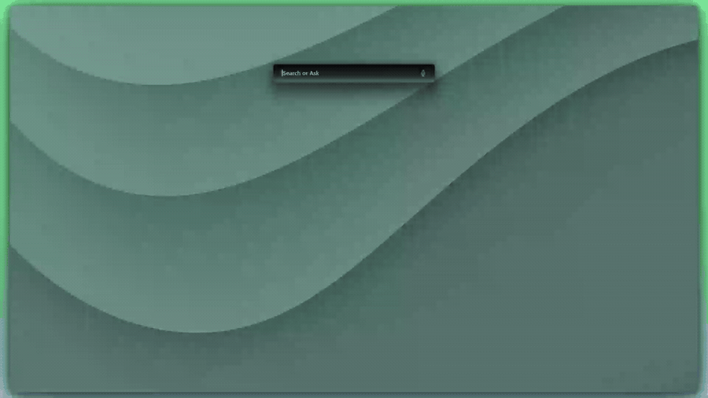
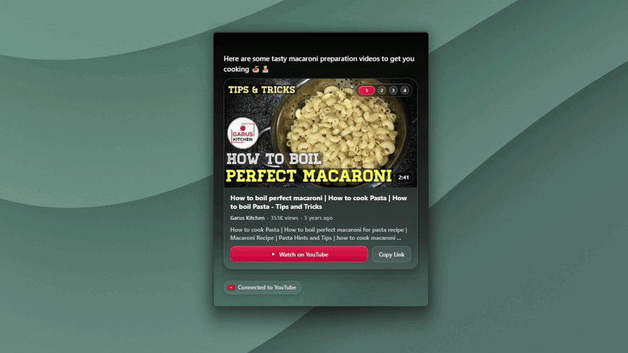
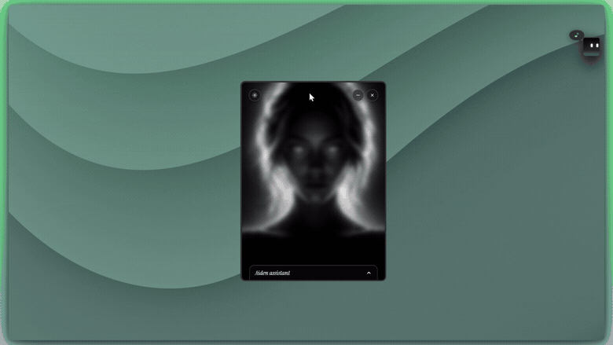
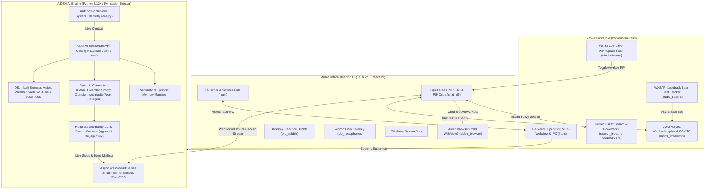

<div align="center">

# AIDEN Assistant

**A shortcut-summoned, living Windows desktop companion with instant Spotlight launching, rich interactive glass cards, a seamless single-view inbuilt browser, privacy-first local file hunting, and background Antigravity Work delegation.**

Built with **Tauri v2 + Rust**, **React 19 + TypeScript**, and an autonomous **Python AI engine**.

[](https://github.com/Eliud-Ke/AIDEN_assistant/releases/latest)
[-0078D6?style=flat-square&logo=windows)](https://github.com/Eliud-Ke/AIDEN_assistant/releases/latest)
[](https://v2.tauri.app/)
[](https://react.dev/)
[](https://www.python.org/)
[](LICENSE)

[**Download Latest Installer (.exe / .msi)**](https://github.com/Eliud-Ke/AIDEN_assistant/releases/latest) · [**Shortcuts**](#-usage--keyboard-shortcuts) · [**Architecture**](#-system-architecture) · [**Build from Source**](#-developer-setup)

</div>

---

<div align="center">
  
</div>

---

## ⚡ Quick Install (Windows 10 / 11)

No build tools required for end users:

1. Download the latest **`AIDEN Assistant_<version>_x64-setup.exe`** (or `.msi`) from [**GitHub Releases**](https://github.com/Eliud-Ke/AIDEN_assistant/releases/latest).
2. Run the installer and launch **AIDEN Assistant** — the bundled Python engine (`aiden-engine.exe`) boots automatically in the background.
3. Open **Authentication** in the Launcher and add your **OpenAI API Key** (stored encrypted in **Windows Credential Manager**, never in plaintext).
4. *(Optional)* Connect **Gmail**, **Google Calendar**, and **Spotify** inside the **Integrations** tab.
5. *(Optional)* Install [**Voidtools Everything**](https://www.voidtools.com/) + the `es.exe` CLI on your `PATH` to unlock sub-10ms local file & folder results inside the Spotlight tray.
6. *(Optional)* Install Google **Antigravity CLI (`agy.exe`)** to unlock headless background **Antigravity Work** task delegation.

---

## ✨ What AIDEN Actually Does

### 🪟 Upper-Third Liquid Glass Pill & Conjoined Spotlight Launcher
Summoned instantly via **`Win + Space`** (native Win32 `WH_KEYBOARD_LL` hook that leaves solo `Win` and every other `Win + *` system shortcut untouched), **`Ctrl + Shift + Space`**, or clicking the Living PiP Cube:
* **Native Windows 11 Acrylic Chrome (`native_window.rs`)**: Borderless, DWM-blurred floating pill in the upper third of your monitor with custom spring morphing (`WindowMorpher`) and live Windows Accent Color adaptation.
* **Instant Conjoined Search Tray (`search_index.rs` + `bookmarks.rs`)**: Type to fuzzy-search before sending to AI, ranked in three clean tiers:
  1. **Installed Apps & System Tools** — Start Menu, Registry, UWP apps, and Windows tools with cached native icons.
  2. **Cross-Browser Bookmarks** — Reads bookmarks and offline cached favicons across **Edge, Zen, Chrome, Brave, Vivaldi, Opera / Opera GX, and Firefox**.
  3. **Folders & Files** — Live parallel directory & file queries via Everything CLI (`es.exe`) when available.
* **Power-User Launch Actions**: `Enter` to open, **`Shift + Enter`** to Run as Administrator (or insert a newline & dismiss the tray while writing a prompt), and **`Ctrl + Enter`** to reveal in File Explorer (resolving `.lnk` shortcuts to their real `.exe` target) or copy a bookmark URL to clipboard.
* **Push-to-Talk Voice Mode (`voice_engine.py`)**: Click the mic button or hold `Shift` inside the pill for fluid Siri-style aurora voice dictation — no always-on wake-word mic listener running in the background.

### 🧊 The 68×68 Living PiP Companion Cube
When asleep or minimized, AIDEN morphs smoothly into a draggable **68×68 Picture-in-Picture cube** docked across single or multi-monitor setups:
* **45fps Expressive Eyes (`PipSquareEyes.tsx`)**: Smooth cursor-tracking eyes and eyebrows, headpats, idle animations, and a dizzy spin reaction when dragged rapidly.
* **Battery Awareness (`pip_bubble`)**: Floating speech-bubble reactions when plugging in, unplugging, hitting low battery (≤ 20%), or reaching full charge.
* **Spotify Groove Mode (`pip_headphones` + `audio_beat.rs`)**: Automatically detects Spotify playback via Windows GSMTC, equips an animated **AirPods Max headphones overlay**, and bops the cube in sync with your live bass beat via **WASAPI loopback audio analysis**.
* **Antigravity Work Expression**: When an Antigravity CLI job runs in the background, AIDEN switches to a calm **breathing emerald-green rim glow**, focused working eyes, and a floating **rotating grey gear bubble**, followed by a celebratory **finished animation** (happy arched eyes, bounce, sparkle, and green `✓` bubble) when complete.

<div align="center">
  
</div>

### ⚙️ Antigravity Work Mode (Headless CLI Agent Delegation)
For complex multi-step coding, refactoring, file organization, or PC automation tasks, AIDEN delegates work asynchronously to the local **Google Antigravity CLI (`agy.exe`)** without blocking your chat:
* **Human-in-the-Loop Plan Gate (`agy_plan_task` / `agy_revise_plan`)**: Runs `agy.exe --mode plan` first to inspect your workspace read-only, summarizes the execution plan, affected paths, and any serious risks, and waits for your explicit approval before modifying anything.
* **Live Inline Chat Card (`AntigravityWorkCard.tsx`)**: Once approved, `agy_execute_task` launches Full Turbo mode asynchronously and streams real step-by-step CLI procedures right inside the chat stream with the official Google Antigravity icon, a rotating metallic grey gear, a bare monospace elapsed timer, and a direct **`■ Stop`** process-tree kill button (`taskkill /F /T /PID`).
* **Hover-Minimize to Background**: Hover over the inline card to reveal its springy **Minimize** button — collapsing the card tells AIDEN you've seen it and want to keep chatting normally while Antigravity keeps working quietly in the background.
* **Collision-Safe Turn-Barrier Mailbox (`server.py` + `main.py`)**: Background completions queue cleanly between active LLM turns (never clobbering an active stream or erasing your unsent draft in `Ask Aiden`), hold silently while minimized/asleep until you open AIDEN, and preserve the `antigravity_work` connector across `×` Sleep/Wake cycles.

### 🧩 Dynamic Google A2UI v0.9 Generative Surfaces (`A2UISurface.tsx`)
Beyond static markdown and fixed cards, AIDEN runs a custom **Google A2UI v0.9** renderer (`tools_a2ui.py` + `A2UISurface.tsx`) backed by a zero-latency side-channel auto-mounter and safe zero-`eval` reactive formulas (`aiden.glass.v1` catalog):
* **Live Checklists & Progress Tracking**: Packing lists, onboarding checklists, and multi-step routines with live checkable items, strikethrough completion, and automatic `pctTrue(...)` / `countTrue(...)` progress bars.
* **60fps Interactive Calculators**: Dinner bill splitters, loan/budget sliders, and unit converters that recalculate locally in real time as you drag sliders — zero network round-trips or card flicker.
* **Decision Matrices, Quizzes & Plan Gates**: Switchable `Tabs` comparisons, `ChoiceChips` selectors, inline mini-forms, PC diagnostics dashboards, and interactive Antigravity **Plan Gate** cards (`Approve & Run` / `Revise` / `Cancel`).

<div align="center">
  
</div>

### 🃏 Zero-Yapping Interactive Glass Cards
Instead of dumping walls of text, AIDEN answers with one crisp conversational line paired with a rich interactive card inside the pill:
* **Weather (`WeatherCard`)** — Live conditions, hourly/daily breakdowns, and dynamic visuals.
* **Live Location (`LocationCard`)** — Interactive Leaflet map card on demand.
* **Google Calendar (`CalendarCard`)** — Agenda view, quick scheduling, cancellation, and automatic overlap/conflict detection cards.
* **Gmail (`GmailCard`)** — Unread inbox & search cards powered by a warm persistent IMAP session with batched `UID FETCH` (~350–730ms tool latency), plus reading, drafting, sending, replying, and archiving.
* **Spotify (`Spotify*Card`)** — Dedicated interactive cards for Tracks, Artists, Albums, Public Playlists, and your Personal Library Playlists, plus direct playback, shuffle/repeat, and Liked Songs control.
* **YouTube (`YouTubeCard`)** — Zero-config Hero Video Card with a 4-dot morphing carousel (`search_youtube`) and quiet single-video walkthrough suggestions (`video_suggestion`), complete with one-click browser playback and link copy.
* **Hardware Glass Sliders (`SystemSlider`)** — Interactive volume and display brightness controls right inside the reply.
* **Rich Markdown (`MarkdownContent`)** — GitHub Flavored Markdown, comparison tables, syntax-highlighted code blocks (`highlight.js`), and inline/display LaTeX math (`KaTeX`).

<div align="center">
  
</div>

### 🌐 Aiden Browser (`960×600` Single-View Inbuilt WebView2)
Instead of scattering links across external tabs when you only want a quick view or watch, AIDEN morphs smoothly from her chat pill into a distraction-free, native **WebView2** browser right inside her Liquid Glass window:
* **Single-View Simplicity (Zero Tab Clutter)**: Strictly one active view per link — no `+` new-tab bar, no bookmark strips, and invisible scrollbars. Clicking **`← Return to chat`** (or pressing `Esc` / sleeping AIDEN) **destroys** the `aiden_browser` child WebView immediately with zero lingering background memory or zombie audio.
* **Seamless `44px` Top Bar & Concave Corner Bleed**: Houses a clean monochrome globe brand pill, `Back` / `Forward` / `Reload`, a frosted URL pill, `External ↗` launch, and `Return to chat`, paired with subtle `12px` concave inner-corner SVG fillets bleeding directly into the edge-to-edge viewport below.
* **Siri Aurora Horizon Loading Curtain**: While a page initializes off-screen behind the themed WebView2 surface, AIDEN plays a smooth dark/light **Siri Aurora Horizon** glow with spinning Constellation dots (**`Just a sec...`**) and reveals the page cleanly on first paint — eliminating cold white flashes.
* **True Fullscreen & Persistent Session**: Cookies and sign-ins persist cleanly in `%LOCALAPPDATA%\AidenAssistant\browser_profile`, and HTML5 fullscreen video (like YouTube) expands `aiden_browser` cleanly across the full display while hiding the corner fillets until exit.
* **Smart App-vs-Browser Routing & Escape Hatch**: Desktop/Store/PWA apps (`Spotify`, `VS Code`, `Obsidian`, `WhatsApp`, `Calculator`) still launch natively via `launch_app`, while websites, Gmail/Calendar browser opens, direct YouTube URLs, and links inside chat cards (`YouTubeCard`, `GmailCard`, `CalendarCard`, `LocationCard`, `MarkdownContent`) prioritize **Aiden Browser** (`browser_navigate`, `browser_scroll`, `browser_close`). Hold **`Shift + Click`** or ask to *"open in Chrome/Edge"* anytime to launch your external browser instead.

<div align="center">
  
</div>

### 🗂️ AI File Agent (`file_system` — Zero-Read Privacy Connector)
Everyday file hunting, inspecting, organizing, and cleanup without ever opening or reading personal file contents:
* **Tier 1 Instant Index (`file_search`)**: Queries local **Everything (`es.exe`)** in milliseconds to return top matching files and folders (no read content, noise paths excluded).
* **Tier 2 Async Parallel Hive-Mind Swarm (`file_agent_search` + `FileAgentCard.tsx`)**: When Tier 1 misses or is offline, dispatches a live branching visual swarm across your user directories (and wakes you automatically via the Turn-Barrier Mailbox to finish any chained move/copy/open action).
* **Native Win32 File Operations**: Highlights items directly inside File Explorer using native `SHOpenFolderAndSelectItems` PIDLs (`file_open`), resolves shorthand destinations cleanly (`Desktop`, `Downloads`, `Documents`, `Pictures`, `Videos`, `Music`), copies with 2 GB guardrails (`file_copy`), and moves deleted items safely to the Windows **Recycle Bin** via `SHFileOperationW` (`file_trash`) — never permanent deletion.

### 👁️ Screen Vision, Live Web Grounding & Hardware Awareness
* **Screen Vision (`look_at_screen`)**: Inspects your full screen, active window, or a specific background window by name to read errors, explain code, or summarize what you're looking at.
* **Live Grounded Web Search (`grounded_web_search`)**: Searches live web sources for current events, docs, and real-time facts with clean clickable citations.
* **Autonomic Nervous System (`ans.py`)**: Feeds real-time system vitals (battery, CPU, RAM, active focus, open windows, currently playing media, active Antigravity jobs, notification counts) directly into AIDEN's context.

### 🎛️ Control Launcher, Dual Theme & Long-Term Memory
* **Dual-Theme Circular Wipe**: Instant origin-aware circular ripple transition between **Dark Velvet** and **Warm Biscuit Cream**.
* **Visual Long-Term Memory Manager**: Browse, add, inline-edit, and delete categorized memories in `%LOCALAPPDATA%\AidenAssistant\memory.json`, backed by automatic conversation summarization in `episodic_ledger.json`.
* **Personality & Rules Editor**: Customize AIDEN's identity vibe and custom operational rules in `user_preferences.json`.
* **System Tray & Process Supervision**: One-click **Boot up**, **Restart**, **Shutdown**, and **Exit** from the Launcher or Windows System Tray, with all secrets encrypted in **Windows Credential Manager**.

<div align="center">
  
</div>

---

## 🔌 Built-In Tools & On-Demand Connectors

AIDEN uses an MCP-style dynamic connector registry (`backend/connectors.py`) that mounts specialized tool stacks into RAM only when needed to keep latency and token overhead low:

| Category | Status | Capabilities |
| :--- | :---: | :--- |
| **Core OS & Media** | ✅ Active | App launching, active window inspection & closing, Windows Settings deep-links, Recycle Bin, volume & brightness sliders, universal media playback (`play/pause/next/prev/restart`), power management, Bible passages |
| **Aiden Browser (Core)** | ✅ Active | Single-view `960×600` inbuilt WebView2 browser (`open_in_browser`, `browser_navigate`, `browser_scroll`, `browser_close`) with Siri Aurora loading curtain, persistent profile, fullscreen video sync, and instant destruction on return |
| **YouTube (Core)** | ✅ Active | Zero-config direct tools (`search_youtube` 4-dot Hero Carousel + selective `video_suggestion` Hero Walkthrough) with optional `YOUTUBE_API_KEY` override — opens directly into Aiden Browser |
| **Dynamic UI (`A2UI v0.9`)** | ✅ Active | Generative interactive glass surfaces (`render_a2ui_surface`): live progress checklists, 60fps reactive calculators, tabbed comparisons, forms, quizzes, and Antigravity Plan Gate cards |
| **Vision & Web** | ✅ Active | Screen Vision (`look_at_screen`: whole screen / active / background window), Live Grounded Web Search, Weather Forecast, Live Location |
| **Gmail** | ✅ Active | Persistent warm IMAP + SMTP: unread inbox, fast search, read, draft, send, reply, mark read, archive |
| **Google Calendar** | ✅ Active | OAuth 2.0: daily/weekly agenda, availability & conflict detection, event creation, update, cancellation |
| **Spotify** | ✅ Active | OAuth 2.0: search tracks/artists/albums/playlists, browse personal library playlists, play items/playlists, shuffle/repeat, like/unlike tracks, active device check |
| **Notes Vault (Obsidian)** | ✅ Active | Auto-discover local Obsidian vaults, scan folders, full-text note search, read/create/edit Markdown notes (`overwrite`/`append`/`insert_after_text`/`replace_text`), `obsidian://` deep-link open, and `[[wikilink]]` graph mapping |
| **Antigravity Work** | ✅ Active | Headless `agy.exe` delegation: read-only Plan Gate (`agy_plan_task` / `agy_revise_plan`), async Full Turbo execution (`agy_execute_task`) with live inline CLI streaming & hover-minimize, status checks (`agy_check_status`), and process-tree cancel (`agy_cancel_task`) |
| **AI File Agent** | ✅ Active | Zero-read privacy connector (`file_system`): Tier 1 Everything (`es.exe`) search + Tier 2 async Hive-Mind Swarm (`file_agent_search` / `file_agent_stop`), directory listing, folder/file creation, smart moves/copies, native Explorer reveal (`SHOpenFolderAndSelectItems`), and Recycle-Bin-only trash |

---

## 🏛️ System Architecture



---

## 📁 Repository Structure

```text
AIDEN_assistant/
├── backend/
│   ├── main.py                   # Master Sleep <-> Awake loop, Turn-Barrier & Responses API core
│   ├── server.py                 # Async WebSocket server (port 8765) & proactive Turn-Barrier Mailbox
│   ├── ans.py                    # Autonomic Nervous System hardware/window/media/job telemetry
│   ├── voice_engine.py           # Push-to-Talk speech capture & audio meter helpers
│   ├── shortcut_detector.py      # Configurable keyboard shortcut fallback (Ctrl+Shift+Space)
│   ├── connectors.py             # Dynamic on-demand connector registry
│   ├── tool_registry.py          # Unified tool dispatch map
│   ├── tools_system.py           # OS controls, look_at_screen, web search, weather, media
│   ├── tools_browser.py          # Single-view Aiden Browser open, navigate, scroll & close tools
│   ├── tools_gmail.py            # Persistent warm IMAP/SMTP Gmail tools
│   ├── tools_calendar.py         # Google Calendar OAuth & conflict-aware scheduling tools
│   ├── tools_spotify.py          # Spotify Web API search, library & playback tools
│   ├── tools_obsidian.py         # Obsidian vault discovery, search, CRUD, deep-link & wikilink graph
│   ├── tools_files.py            # Zero-read local file search, Explorer reveal, move/copy & Recycle Bin
│   ├── file_agent.py             # Tier 2 async parallel Hive-Mind File Explorer swarm engine
│   ├── tools_youtube.py          # Zero-config YouTube search & silent walkthrough side-channel tools
│   ├── tools_a2ui.py             # Google A2UI v0.9 validator & side-channel surface queue
│   ├── tools_antigravity.py      # Headless Antigravity CLI Plan Gate & async Turbo worker
│   ├── status_tags.py            # Shuffled-bag organic tool status variations (10 phrases/tool)
│   ├── memory_manager.py         # Semantic facts (memory.json) & episodic ledger
│   ├── configuration.py          # Identity vibe, operational rules & preferences
│   ├── auth_manager.py           # Windows Credential Manager integration (keyring)
│   ├── aiden-engine.spec         # PyInstaller standalone sidecar build specification
│   └── requirements.txt          # Python dependencies
├── frontend/
│   ├── src/
│   │   ├── components/
│   │   │   ├── ChatPill.tsx             # Upper-third Liquid Glass pill, search tray & Aiden Browser top bar
│   │   │   ├── A2UISurface.tsx          # Google A2UI v0.9 renderer & zero-eval reactive engine
│   │   │   ├── YouTubeCard.tsx          # Headerless Hero Video Card & 4-dot morphing carousel
│   │   │   ├── AntigravityWorkCard.tsx  # Live inline Antigravity card with hover-minimize & stop
│   │   │   ├── FileAgentCard.tsx        # Live parallel File Explorer Hive-Mind swarm visualizer
│   │   │   ├── PipSquareEyes.tsx        # 68x68 living cube eyes, working green glow & Spotify state
│   │   │   ├── PipCommentBubble.tsx     # Floating battery, spinning gear & status speech bubble
│   │   │   ├── PipHeadphones.tsx        # Animated AirPods Max overlay window
│   │   │   ├── MarkdownContent.tsx      # GFM + highlight.js + KaTeX renderer
│   │   │   ├── WeatherCard.tsx          # Interactive glass weather forecast card
│   │   │   ├── LocationCard.tsx         # Interactive Leaflet map card
│   │   │   ├── CalendarCard.tsx         # Agenda & conflict detection card
│   │   │   ├── GmailCard.tsx            # Inbox & email search card
│   │   │   ├── Spotify*Card.tsx         # Tracks, Artist, Albums, Playlists & Library cards
│   │   │   └── SystemSlider.tsx         # Native-feel glass volume & brightness slider
│   │   ├── utils/
│   │   │   └── aidenBrowser.ts          # Card & Markdown link router into Aiden Browser
│   │   ├── App.tsx                      # Control Launcher (Auth, Integrations, Memory, Prefs)
│   │   └── main.tsx                     # Multi-window entrypoint router
│   └── src-tauri/
│       ├── src/
│       │   ├── lib.rs                   # Async Tauri IPC commands, multi-webview browser & tray
│       │   ├── aiden_browser_hud.js     # Concave inner-corner bleed fillets & HTML5 fullscreen bridge
│       │   ├── native_window.rs         # DWM Acrylic, WindowMorpher, bounded WinRT GSMTC
│       │   ├── win_hotkey.rs            # Native Win32 WH_KEYBOARD_LL hook (Win + Space)
│       │   ├── search_index.rs          # Fuzzy app/file/folder indexer & Win32 launcher
│       │   ├── bookmarks.rs             # Cross-browser bookmark & offline favicon extractor
│       │   └── audio_beat.rs            # Real-time WASAPI loopback bass-beat tracker
│       ├── Cargo.toml                   # Rust dependencies
│       └── tauri.conf.json              # 4-window config + bundled aiden-engine sidecar
├── RELEASE_WORKFLOW.md           # Full PyInstaller + Tauri build & GitHub Release SOP
└── README.md
```

---

## 🎮 Usage & Keyboard Shortcuts

| Action | Trigger | Behavior |
| :--- | :--- | :--- |
| **Wake / Toggle AIDEN** | **`Win + Space`**, `Ctrl + Shift + Space`, or click Living Cube | Blooms the Liquid Glass pill in the upper third, or minimizes it back to the 68×68 PiP cube |
| **Navigate Search Tray** | `↑` / `↓` | Move selection across Apps, Bookmarks, and Folders & Files |
| **Send / Launch** | `Enter` | Opens the highlighted search result, or sends your message to AIDEN |
| **Run as Admin / Newline** | `Shift + Enter` | Launches the selected app/item elevated as Administrator; when typing a prompt, inserts a newline and dismisses the search tray |
| **Reveal in Folder / Copy URL** | `Ctrl + Enter` | Opens File Explorer selecting the file/folder (resolves `.lnk` shortcuts to their real `.exe` target), or copies a bookmark URL to clipboard |
| **Open Link in Aiden / External** | Click / **`Shift + Click`** on chat card links | Normal clicks open inside **Aiden Browser** (`960×600`); `Shift + Click` or the `↗` bar button opens your OS default browser |
| **Return from Aiden Browser** | `← Return to chat` or `Esc` | Destroys the child `aiden_browser` WebView completely and morphs smoothly back to chat |
| **Minimize to PiP Cube** | `Ctrl + M` or top-right minimize button | Collapses the pill into the draggable 68×68 living companion cube while preserving chat history |
| **Close / Sleep AIDEN** | `Esc`, top-left `×`, or sleep shortcut | Consolidates session memory and transitions AIDEN to her asleep 68×68 cube (preserving active Antigravity jobs) |
| **Open Launcher** | Left-click System Tray icon | Opens Authentication, Integrations, Preferences, and Memory Manager |
| **Engine Controls / Exit** | Right-click System Tray icon | Quick **Open**, **Boot up**, **Restart**, **Shutdown**, or complete **Exit** |

---

## 🪟 Tiling Window Managers (GlazeWM Setup)

If you use [GlazeWM](https://github.com/glzr-io/glazewm), add an ignore rule in `~/.glzr/glazewm/config.yaml` so GlazeWM does not tile AIDEN's Launcher, Floating Pill, or PiP overlay windows (`AIDEN`, `AIDEN Chat`, `AIDEN Bubble`, `AIDEN Headphones`):

```yaml
window_rules:
  - commands: ["ignore"]
    match:
      - window_process: { equals: "AIDEN Assistant" }
      - window_process: { equals: "frontend" }
        window_title: { regex: "(?i)^AIDEN" }
      - window_title: { regex: "(?i)^AIDEN" }
```

Reload your config with `Alt + Shift + R` or:
```powershell
glazewm command wm-reload-config
```

---

## 🛠️ Developer Setup

### Prerequisites
* **OS**: Windows 10 / 11 (64-bit)
* **Python**: `3.12+` (with `venv` & `pip`)
* **Node.js**: `v20+` and `npm`
* **Rust**: `1.85+` (Rust Edition 2024) via [rustup.rs](https://rustup.rs/)
* **C++ Build Tools**: Visual Studio C++ Build Tools (required for Rust and bundled `rusqlite`)
* **Optional**: [Everything](https://www.voidtools.com/) + `es.exe` CLI for instant local file/folder search in the Spotlight tray, and Google **Antigravity CLI (`agy.exe`)** for background Work Mode delegation

### 1. Clone & Set Up Backend
```powershell
git clone https://github.com/Eliud-Ke/AIDEN_assistant.git
cd AIDEN_assistant/backend
python -m venv venv
.\venv\Scripts\activate
pip install -r requirements.txt
cd ..
```

### 2. Install Frontend & Run Dev Mode
```powershell
cd frontend
npm install
npm run tauri dev
```

This launches the Vite dev server (`http://localhost:1420/`), compiles the Rust/Tauri shell, auto-boots the Python AI engine on WebSocket port `8765`, and opens the Launcher + Living PiP Cube.

### 3. Production Installers & Releases
Packaging a standalone `.exe` (NSIS) and `.msi` (WiX) requires compiling the frozen Python sidecar (`backend/aiden-engine.spec`) before running `npm run tauri build`. See [**RELEASE_WORKFLOW.md**](RELEASE_WORKFLOW.md) for the complete step-by-step build, archiving, and GitHub Release procedure.

---

## 🛡️ License

This project is licensed under the **MIT License** — see the [LICENSE](LICENSE) file for details.
