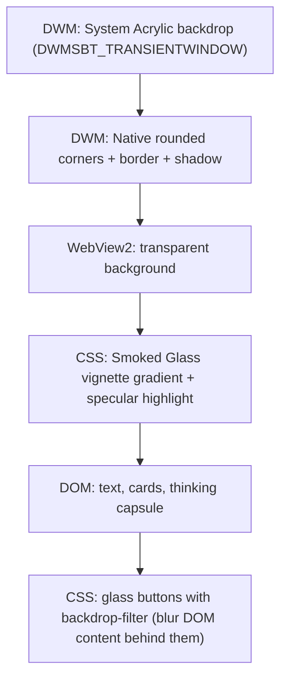
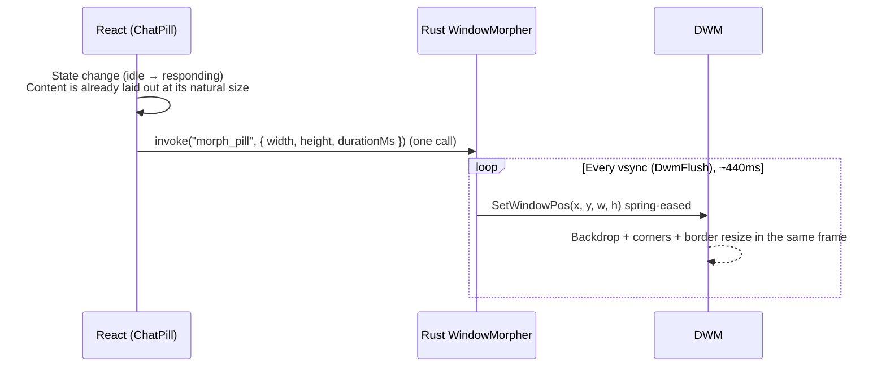

# UI Framework Change: Native DWM Pill

**Branch:** `UI-framework-change` (branched from `main` @ `bf6b1b1`)
**Status:** 📝 Plan. Nothing is implemented yet.
**Target OS:** Windows 11 (dev machine is build 26300 / 26H2)

---

## 1. Goal

Make the floating pill feel like a native Windows surface (Settings, Start, Quick Settings). It should stay smooth with **zero lag between the blur and the UI**, and still look like the original Aiden design:

- ✅ Keep the Apple Smoked Glass vignette (same gradient stops)
- ✅ Keep the specular top highlight
- ✅ Keep the glass buttons (`+`, command capsule, mic, minimize) with their lens blur
- ✅ Keep the content animations (thinking shimmer, polish tags, top-down response spring)
- ⚠️ **Trade-off we accept:** the custom 28–40px CSS corner radius goes away. Windows 11 draws its own rounded corners instead (8px, or 4px with "small").

---

## 2. Why the current approach can't be fixed

Today we draw **two shapes** and try to keep them in sync:

| Layer | Who draws it | Shape |
|---|---|---|
| Blur | `Windows.UI.Composition` visual (`composition.rs`), clipped to a rounded rectangle | DWM geometry |
| Pill (vignette, border, content) | Chromium / CSS inside a big transparent 640×130–720 window | CSS box |

They live in **two separate render pipelines** (Chromium compositor and DWM compositor), with separate clocks, separate frame timing, and an IPC / WebSocket gap between them. Every approach we tried (rAF polling, GPU keyframes, dual WebSocket listeners) only shrinks the gap. None of them remove it. CSS `height: auto` transitions and `ResizeObserver` timing make it worse.

**The fix is to stop having two shapes.**

---

## 3. New architecture: the window *is* the pill

The HWND gets resized to exactly the pill's size. DWM paints the acrylic backdrop, the rounded corners, the border and the shadow **for the whole window**, the same way it does for Settings. Chromium only paints what goes *on top* (vignette, text, buttons), on a transparent background.

There's only one shape (the window rectangle), so the blur and the UI **can't drift apart**. When the window moves or resizes, DWM moves the backdrop and corners in the same composition frame.

### Layer-by-layer mapping (old → new)

| Visual element | Old implementation | New implementation |
|---|---|---|
| Desktop blur | `CompositionHost` + `HostBackdropBrush` + clip geometry | `DWMWA_SYSTEMBACKDROP_TYPE = DWMSBT_TRANSIENTWINDOW` (Acrylic) on the pill HWND |
| Rounded corners | CSS `border-radius: 28/30/40px` + DWM clip geometry | `DWMWA_WINDOW_CORNER_PREFERENCE = DWMWCP_ROUND` |
| Outer border (`1px rgba(255,255,255,.14)`) | CSS `border` | `DWMWA_BORDER_COLOR` (follows the native rounded corners). A CSS border would get its corners cut off. |
| Drop shadow (`0 16px 36px …`) | CSS `box-shadow` (needed the 640px transparent headroom) | Native DWM window shadow |
| Vignette gradient | CSS `background: linear-gradient(...)` on `.siri-unified-pill` | **Same CSS**, now filling `100vw × 100vh` |
| Specular top rim | CSS `inset 0 1px 0 rgba(255,255,255,.35)` | **Same CSS** (inset shadow) |
| Glass buttons + lens blur | CSS `backdrop-filter` / `#aiden-stream-lens-blur` | **Same CSS**. It still blurs the DOM text and cards behind the buttons, and the desktop acrylic shows through underneath. |
| Light / dark | CSS classes | CSS classes **+** `DWMWA_USE_IMMERSIVE_DARK_MODE` so the acrylic tint matches |
| Blur "transparency" | Composition visual opacity | Alpha of the CSS vignette over the acrylic. The system acrylic tint itself is **not** customizable. |

---

## 4. Motion model: one animator, natively driven

Current problem: CSS animates the box, then something has to tell DWM to follow.
New model: **Rust animates the window; the DOM never animates the pill's size.**

Key rules:

1. **No CSS transitions on pill `width` / `height` / `min-height` / `padding`.** The DOM jumps to its final layout at T=0. The window works like a mask that springs open or closed over it. This is how native resizes stay smooth.
2. **Content is top-anchored at a fixed column width** (466px, minus padding), so text never reflows mid-morph.
3. **Target size is known at T=0.** The DOM is already laid out, so a single synchronous `getBoundingClientRect()` on the content gives the final height. We don't need the backend `targetHeight` estimate, `ResizeObserver` debounces, or per-frame polling.
4. **Spring curve lives in Rust** (same feel as `cubic-bezier(0.18, 1.25, 0.35, 1)`, or a real damped spring). It's frame-paced with `DwmFlush()` so steps line up with the compositor at 60, 120 or 144 Hz.
5. **Horizontal morphs** (idle 466px ↔ listening 280px) animate `x` and `width` together so the pill stays centered.
6. **Content entrance animations stay in CSS** (opacity / transform only: thinking fade, `siriTopDownSpring`, polish tags). These are compositor-only and never touch layout.

### The WebView2 resize concern & the "oversized webview" trick

Calling `SetWindowPos` every frame makes Tauri resize the WebView2 controller on `WM_SIZE`. That can force Chromium to reallocate its swapchain (the cause of our very first stutter).

**Mitigation (to be verified in Phase 0):** size the webview **once** to the maximum pill size (466 × 620) and stop it from following `WM_SIZE`. Then only the parent HWND resizes, and DWM clips the webview. Chromium never sees a resize, so there's no swapchain churn and no reflow. Possible ways to do it:
- Tauri multi-webview (`Window` + `add_child` webview with fixed bounds, `unstable` feature), or
- Subclass the pill HWND and swallow the size update for the webview controller.

If the plain approach (webview follows `WM_SIZE`) is already smooth at 144 Hz in the spike, we skip this trick.

---

## 5. Known platform caveats (to be checked in Phase 0)

| # | Caveat | Mitigation |
|---|---|---|
| C1 | **System backdrops fall back to a solid color when the window is inactive.** The pill is often unfocused (always-on-top overlay). | Subclass the window proc and handle `WM_NCACTIVATE` so the window always reports active. Fallback: legacy `SetWindowCompositionAttribute` / `ACCENT_ENABLE_ACRYLICBLURBEHIND` (stays on while inactive, but has known drag/resize lag on some builds). |
| C2 | Native rounded corners / shadow may not apply to Tauri `transparent: true` + `decorations: false` windows (layered-window behavior). | Spike combos: `transparent: false` + transparent webview background + `DwmExtendFrameIntoClientArea(-1)`; `shadow: true`. |
| C3 | Acrylic turns off with **Transparency effects = off**, Battery Saver, or Remote Desktop. | Detect it and fall back to a solid smoked-glass CSS background (looks intentional, not broken). |
| C4 | System acrylic tint/opacity isn't customizable. | The CSS vignette over it controls the final look. The gradient stops may need a small retune because the acrylic base tint differs from our raw `HostBackdropBrush`. |
| C5 | `DWMWCP_ROUND` radius is fixed by the OS (~8px). Pill "capsule" shapes are no longer possible. | Accepted trade-off. Option: `DWMWCP_ROUNDSMALL` (4px). |
| C6 | `DWMSBT_*` needs Win11 22H2+ (build 22621+). | Dev machine is 26300 ✅. For older builds: legacy accent acrylic, or the C3 solid fallback. |

---

## 6. What we delete / keep / add

### 🗑️ Delete
- `frontend/src-tauri/src/composition.rs` (the whole `CompositionHost`)
- `CompositionState`, plus `animate_chat_pill_shape`, `handle_dwm_event` and `start_dwm_ws_listener` in `lib.rs`
- `tungstenite` dependency (`Cargo.toml`)
- Shape params on `set_chat_pill_size` (`shape_x/y/w/h/r`, `pill_mode` shape table)
- `estimate_response_height` + `targetHeight` in `backend/server.py`. Also the `clear_response` / `voice_start` / `voice_cancel` echo broadcasts if nothing else uses them.
- In `ChatPill.tsx`: `triggerGpuShapeAnimation`, `prevModeRef`, `collapseTimerRef`, `lastSyncHeightRef`, and the responding-mode `ResizeObserver` debounce
- In `ChatPill.css`: pill `border-radius`, outer `box-shadow`s, outer `border`, size transitions on `.siri-unified-pill*`, `siriVoicePillMorph` / `siriRespondingBouncy` size keyframes, and the 87px / 18px positional headroom in `.chat-pill-desktop-window`

### ✅ Keep (unchanged or nearly)
- Vignette gradients (dark + light), specular inset highlight
- Glass buttons, command capsule, lens-blur SVG filter
- Thinking capsule, polish tags, top-down response entrance, Spotify/Weather/etc. cards
- WebSocket protocol between UI and backend (minus the DWM-only additions)

### ➕ Add
- `frontend/src-tauri/src/native_window.rs`
  - `apply_pill_chrome(hwnd, dark)`: backdrop type, corner preference, border color, immersive dark mode
  - `install_active_hook(hwnd)`: `WM_NCACTIVATE` subclass (C1)
  - `WindowMorpher`: vsync-paced spring animator for `x / y / w / h`, cancellable and retargetable mid-flight (the new target picks up from the current size and velocity)
- Tauri commands: `morph_pill { width, height, durationMs }`, `set_pill_theme { dark }`
- `ChatPill.tsx`: a single `requestMorph(mode)` called synchronously when mode or hover changes, which measures the content and sends one `morph_pill`

---

## 7. Phased plan

### Phase 0: Feasibility spike (throwaway, ~½ day) 🔬
A minimal test window, separate from the real UI. **Go / no-go gate.**
- [ ] Acrylic (`DWMSBT_TRANSIENTWINDOW`) visible on an undecorated Tauri window with a transparent webview
- [ ] Native rounded corners + native border + shadow show up (C2)
- [ ] Blur stays on when the window is **unfocused** (C1)
- [ ] Per-frame `SetWindowPos` morph 60 → 400px at 144 Hz: no tearing, no white or black flashes, no content jitter
- [ ] Measure: plain webview-follows-resize **vs** oversized fixed webview
- [ ] CSS vignette + `backdrop-filter` button render correctly over the acrylic

**Exit criteria:** all boxes ticked, or a documented fallback chosen for each failure.

### Phase 1: Native shell (Rust)
- [ ] `native_window.rs` with chrome, active hook and `WindowMorpher`
- [ ] Pill window config: final `transparent` / `shadow` combo from the spike, initial size 466×60
- [ ] Positioning: horizontally centered, 15% from the top (unchanged)
- [ ] `morph_pill` / `set_pill_theme` commands
- [ ] Remove `composition.rs`, the WS listener and `tungstenite`

### Phase 2: Frontend restructure
- [ ] `.chat-pill-desktop-window` and `.siri-unified-pill` fill the viewport (no positional headroom)
- [ ] Strip radius, outer shadow, outer border and size transitions
- [ ] Re-tune the vignette stops over system acrylic (dark + light)
- [ ] Check the specular rim and glass buttons against the native corners

### Phase 3: Motion
- [ ] Mode state machine → `requestMorph()` (idle 466×60, listening 280×80, thinking 466×60, responding 466×content)
- [ ] Hover / unhover (`controls-visible`): padding changes instantly, window morphs (+110px)
- [ ] Streaming growth: window retargets as lines are revealed (morpher handles mid-flight retargets)
- [ ] Collapse on dismiss / sleep, then hide
- [ ] Keep all opacity/transform content entrances

### Phase 4: Backend & dead-code cleanup
- [ ] Remove `targetHeight` / `estimate_response_height` and the DWM-only echo broadcasts
- [ ] `cargo check`, `npm run build`, no warnings

### Phase 5: QA matrix
| Scenario | 60 Hz | 144 Hz | Dark | Light | Unfocused |
|---|---|---|---|---|---|
| Wake → idle | | | | | |
| Idle ↔ listening | | | | | |
| Thinking → responding (short / long / card) | | | | | |
| Hover / unhover in responding | | | | | |
| Dismiss → idle → sleep | | | | | |
| Transparency effects OFF fallback | | | | | |
| Multi-monitor / DPI 100% / 150% | | | | | |

---

## 8. Acceptance criteria

1. **Zero blur/UI desync**, guaranteed by construction (one shape).
2. Morphs run at the display refresh rate with no visible stutter at 144 Hz.
3. Vignette, specular rim and glass buttons look the same as on `main`, apart from the corner radius.
4. Acrylic stays visible while the pill is unfocused.
5. A graceful solid fallback when acrylic is unavailable.
6. No per-frame IPC, no WebSocket listener in Rust, no backend height estimation.

---

## 9. Open questions for you

1. **Corner style:** `DWMWCP_ROUND` (~8px, Win11 standard) or `DWMWCP_ROUNDSMALL` (~4px)?
2. **Listening mode:** keep the narrow 280px pill (animates width + x), or keep the full 466px width for simplicity?
3. **Native border:** subtle white rim (`#FFFFFF24`, like the current CSS), the system default, or none?
4. **Scope:** pill only for now, or also move the main control panel window (470×645) to native acrylic afterwards?
